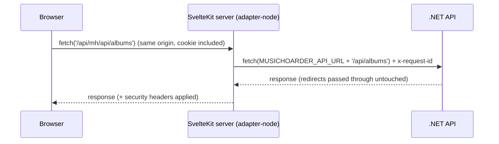

# Frontend (`frontend/`) and Mobile Shell (`mobile/`)

MusicHoarder's user-facing surface is a SvelteKit single-page app served by a Node/Bun server, plus a thin Capacitor shell that loads that same app inside a native web view for iOS and Android. This page covers both. For how to run the whole stack locally, see the root `README.md` and `AGENTS.md`; for deploying the containers, see [`SELF_HOSTING.md`](./SELF_HOSTING.md).

```
Browser / Web view
      │  same-origin /api/mh/[...path]
      ▼
SvelteKit server (adapter-node, Bun)  ──►  .NET API (MusicHoarder.Api)  ──►  PostgreSQL
      ▲                                        ▲
      └── Frontend__PublicBaseUrl              └── Aspire AppHost orchestrates both in dev
```

## Frontend: framework and tooling

| Aspect | Choice | Where |
| --- | --- | --- |
| Framework | SvelteKit 3 + Svelte 5 (runes) | `frontend/package.json` |
| Adapter | `@sveltejs/adapter-node` — a real Node/Bun server, not a static site | `frontend/vite.config.ts` |
| Package manager / runtime | Bun (install, dev, and the production server via `bun build/index.js`) | `frontend/Dockerfile`, `package.json` scripts |
| Language | TypeScript; type-checking via `svelte-check` with the experimental tsgo API | `package.json` (`check` script) |
| Formatting / linting | `oxfmt` + `oxlint` (type-aware via `oxlint-tsgolint`) | `package.json` (`lint`, `format` scripts) |
| Tests | Vitest | `frontend/vitest.config.ts` |
| Releases | Weekly unified semantic-release covering API + frontend | root `AGENTS.md` ("Releases") |

Notable quirks:

- **There is no `svelte.config.js`.** SvelteKit is configured inside `vite.config.ts` through the `sveltekit({...})` plugin — the adapter, CSP, and version polling all live there.
- **`src/lib` is imported as `#lib/…`** (with file extensions, e.g. `#lib/api-client.ts`), mapped in `package.json` under `imports`. There is no `$lib` alias usage for this code and no tsconfig path mapping to maintain.
- **Lint config is generated, never hand-edited.** `.oxlintrc.json` is produced by `frontend/oxlint/generate-config.mjs`, which disables each currently-broken rule for the narrowest file kind and records the finding count — fixing findings and rerunning is how a rule becomes enforced again. Repo-local rules live in `frontend/oxlint/local.mjs` (tested by `local.test.ts`), and the Svelte-markup half of them in `frontend/oxlint/svelte-markup.mjs`, because oxlint only sees `<script>` blocks.
- **Git hooks.** `bun install` in `frontend/` runs the `prepare` script, which sets `core.hooksPath` to the repo-root `.githooks/` directory. Its `pre-push` hook format-checks, lints and type-checks only the frontend files a push changes.

Common commands (from `frontend/`):

```bash
bun run dev            # vite dev server
bun run build          # SvelteKit + adapter-node production build
bun run check          # svelte-kit sync + svelte-check
bun run lint           # oxfmt --check, then oxlint + the custom svelte-markup checks
bun run test           # vitest run
MUSICHOARDER_API_URL=http://localhost:<api-port> PORT=3000 bun run dev   # standalone against a running API
```

## Route structure

Routes live in `frontend/src/routes` in four groups plus shared endpoints. The nav tree itself — labels, paths, per-tab back targets and command-palette entries — is defined once in `frontend/src/lib/nav.ts`.

### `(app)` — the signed-in application

`src/routes/(app)/+layout.ts` sets `ssr = false` (module-scoped `$state` stores read browser-only APIs such as `HTMLAudioElement`) and implements the client-side route guard: after the server has checked the session once at document load, `(app)/+layout.ts` re-checks each path against the user the server handed over and redirects to the app home if it is not allowed. This guard is cosmetic — the API enforces the real authorization rules.

| Route | What it shows |
| --- | --- |
| `/overview` | Signed-in home (the app's `APP_HOME`); "last played" shelves etc. |
| `/library` | Album library ("Albums") |
| `/artists` | Artists ("My tracks" is `/tracks`) |
| `/tracks`, `/track/[id]` | Track list and a single track's detail page |
| `/liked` | Liked songs |
| `/playlists`, `/playlists/[id]` | Playlists and a single playlist |
| `/listening` | Listening history / stats ("Listening") |
| `/chats`, `/chats/[id]`, `/chats/share` | Chat ("Messages"), a conversation, and the PWA share-target landing (a shared song opens a chat share) |
| `/inbox` | Review hub: tag review, duplicate tracks, artist names, album names, AI-flagged items |
| `/add` | "Add" hub: links to `/discover`, `/spotify`, `/following`, `/wishlist`, `/playlist-sync` |
| `/manage` | "Manage" hub: links to `/pipeline`, `/directories`, `/album-quality`, `/quality`, `/clean-edits`, `/grader-trial`, `/performance`, `/stats`, `/history`, `/shares`, `/reports` |
| `/discover` | Discover new music |
| `/spotify` | Spotify integration (connect, playlists) |
| `/following` | Followed artists (release watching) |
| `/wishlist` | Wanted albums/tracks |
| `/playlist-sync` | Spotify ↔ library playlist sync |
| `/pipeline` | Pipeline page: what each background job has done (reads the admin-only background-work API; its TypeScript contract in `src/lib/background-work/types.ts` mirrors `BackgroundWorkContracts.cs` on the API side) |
| `/directories`, `/album-quality`, `/quality`, `/clean-edits`, `/grader-trial` | By-folder view, AI quality grading, album matches, clean edits, and the quality-grader trial/benchmark page |
| `/performance`, `/stats`, `/history` | Performance dashboard, library stats, and change history |
| `/shares`, `/reports` | Share links (including revoked) and reported downloads |
| `/settings` | Settings |

### Everything else

| Route | What |
| --- | --- |
| `/` (`src/routes/+page.svelte`) | Marketing landing page — **server-rendered** (the `(marketing)` group keeps SSR). Shows screenshots from `static/screenshots/`. |
| `/about`, `/contact`, `/privacy`, `/delete-account` | Marketing/info pages, SSR |
| `/login` | Login (passkeys/WebAuthn or email magic link) plus "Try the demo" → `POST /api/auth/demo-login` |
| `/auth/callback` | Auth callback endpoint (+server) |
| `/auth/app` | Hand-off page for the mobile app's `musichoarder://` deep link sign-in |
| `/invite/[token]` (+ `/accept`) | Invite redemption |
| `/share/[token]`, `/shared` | Public share pages and their index |
| `/share-target` | PWA Web Share Target entry; it immediately redirects to `/chats/share` |
| `/sitemap.xml` | Generated sitemap (+server) |

### Backend API endpoints owned by the frontend server

| Endpoint | Purpose |
| --- | --- |
| `/api/mh/[...path]` | The same-origin proxy to the .NET API (below) |
| `/api/spotify/callback`, `/api/spotify/relay` | Spotify OAuth callback and the shared OAuth relay (HMAC-signed `state` via `SPOTIFY_OAUTH_STATE_SIGNING_KEY`, return-origin allowlist) |
| `/api/health` | Container healthcheck target |
| `/api/csp-report` | Receives report-only CSP violations, logs one redacted line each |

## How the frontend talks to the API

The browser never calls the .NET API directly and never needs CORS. Every backend call goes through the **same-origin proxy route** `frontend/src/routes/api/mh/[...path]/+server.ts`, with the path prefix constant `API_PREFIX = '/api/mh'` defined in `frontend/src/lib/library-requests.ts` and used by the big typed client `frontend/src/lib/api-client.ts` (~6k lines: every endpoint, wire types, SSE playback events, passkey flows).



**Where the API base URL comes from** — `frontend/src/lib/server/api-target.ts` reads `process.env` directly (the Aspire-injected names cannot be enumerated in `env.ts`'s fixed schema) and picks the first hit of:

1. `MUSICHOARDER_API_URL` (the normal setting; the AppHost and Docker set it)
2. Aspire service discovery: `services__musichoarder-api__http__0`, `services__musichoarder-api__http` (case variants), or any `services__musichoarder-api__http*` key
3. `ConnectionStrings__musichoarder-api` (case variants)
4. Fallback `http://localhost:5107`

Proxy details worth knowing (`+server.ts`):

- Forwards the request headers minus `host`, adds the `x-request-id` the frontend logged under (so a problem report's network entry leads to both halves' logs).
- Aborts if the API hasn't returned **headers** within 10 s (240 s for the deliberately long-running `/lyrics/transcribe` and `/lyrics/translate`), then streams the body without a timer — SSE progress feeds keep streaming.
- Uses `redirect: 'manual'` so API redirects meant for the browser (e.g. artist portraits on a CDN) pass through as-is, preserving upstream cache headers.
- Returns `504` when the upstream fetch throws, and handles response compression itself (`#lib/server/proxy-compression.ts`).

**Environment variables** are declared in `frontend/src/env.ts` with `defineEnvVars`. All are optional and read at server start:

| Variable | Purpose |
| --- | --- |
| `SPOTIFY_OAUTH_STATE_SIGNING_KEY` | HMAC key for the shared OAuth relay's `state` |
| `SPOTIFY_RETURN_ORIGIN_ALLOWLIST` | Origins the relay may bounce back to |
| `WEBMCP_ORIGIN_TRIAL_TOKEN` | WebMCP origin-trial token |
| `PUBLIC_SITE_URL` | The site's own origin (fallback `https://musichoarder.app`) |
| `PUBLIC_UMAMI_WEBSITE_ID` / `PUBLIC_UMAMI_SRC` / `PUBLIC_UMAMI_RECORDER_SRC` | Optional self-hosted Umami analytics |
| `PUBLIC_LOOPING_URL` / `PUBLIC_LOOPING_APP` | Optional Looping problem-report inbox; unset means it never loads |

### Server hooks and instrumentation

`frontend/src/hooks.server.ts` composes (by hand, not `sequence`, so it stays unit-testable) several concerns on every response:

1. **Request IDs** — `#lib/server/looping` assigns `x-request-id` to every request and logs errors with it (`handleError`).
2. **Security headers** — `#lib/server/security-headers` sets nosniff, `Referrer-Policy`, `frame-ancestors 'none'` + `X-Frame-Options`, COOP, `Permissions-Policy`, and one-year HSTS. The CSP itself is configured **report-only, `auto` mode** in `vite.config.ts`: dynamically rendered pages get a nonce on their inline scripts, prerendered pages (the `/docs` section) ship none — nonce mode cannot prerender. The two inline scripts in `app.html` therefore carry no nonce, which is fine while the policy is report-only (a switch to enforcing needs a hash for them — noted in `app.html`). `style-src` keeps `'unsafe-inline'` because Svelte and bits-ui write style attributes.
3. **Content negotiation** — some documentation-ish URLs can return `text/markdown` instead of HTML (`#lib/server/content-negotiation`, `#lib/content/site-markdown`).
4. **Library preload** — emits `Link: <…>; rel=preload` headers for exactly the two requests the library store makes on a cold start (`#lib/server/library-preload`, with the request URLs pinned in `#lib/library-requests` so the preload and the store can't drift).
5. **Page fills** — fills placeholders in `app.html`, e.g. the hardware skin's stylesheet URL (`#lib/hardware/skin-stylesheet`).

`frontend/src/instrumentation.server.ts` starts an OpenTelemetry `NodeSDK` **only when `OTEL_EXPORTER_OTLP_ENDPOINT` is set**, using standard `OTEL_*` variables and redacting URLs in span processors (`#lib/server/telemetry`). `frontend/src/hooks.client.ts` masks only unexpected client errors (chunk-load failures get a friendly "couldn't load this page" message).

### State management and key libraries

State is Svelte 5 runes — there is no external state library. Module-scoped stores are `.svelte.ts` files, mostly in `frontend/src/lib/stores/`:

- `player.svelte.ts` — the central audio player. In a browser it drives an `<audio>` element; inside the mobile shell it drives `NativeAudio` (`#lib/native/native-audio.ts`), which has the same surface and forwards to the Capacitor plugin. It also syncs playback state across devices (`playback-sync/`, SSE over the proxy).
- Others: `songs.svelte.ts` (the library list, with conditional `If-None-Match` fetches), `playlists.svelte.ts`, `chat.svelte.ts`, `shuffle-prefs`, `command-palette`, `nav-badges`, `theme-surface`, `storage-usage`, etc.

Key dependencies (`frontend/package.json`):

| Library | Role |
| --- | --- |
| `bits-ui` + `tailwind-variants` + `clsx` + `tailwind-merge` | Headless UI primitives (shadcn-style; see `components.json`) and class utilities |
| `svelte-sonner` | Toasts |
| `mode-watcher` | Light/dark mode (its head-script injection is disabled; the first-paint theme marker lives in `app.html`'s inline script) |
| `@lucide/svelte` | Icons |
| `@ui-sdk/svelte` / `@ui-sdk/core` (beta) | Kit ports used by the "hardware skin" easter egg (`#lib/hardware`) |
| `@opentelemetry/*` | Server-side tracing (see above) |

### Styling

Tailwind CSS 4 through the `@tailwindcss/vite` plugin, plus `tw-animate-css`. `frontend/src/app.css` defines the design tokens — Apple's system palette under shadcn's variable names, one neutral family and a brand green tint, with surfaces following iOS's grouped hierarchy — and custom variants (`dark`, `data-open`/`data-closed` matching bits-ui's `data-state` attributes) and utilities (`no-scrollbar`). The hardware skin is deliberately **not** imported here; it is a separate stylesheet requested only when the skin is on.

### PWA and service worker

The frontend is an installable web app: `static/manifest.webmanifest` (`start_url` is the `APP_HOME` constant), Apple meta tags in `app.html`, and `src/service-worker/index.ts`. The service worker is **deliberately minimal**: it precaches only `static/offline.html` and serves it when a top-level navigation fails at the network level, and it displays Web Push chat notifications. It never caches HTML, API responses, audio, or build assets — `/_app/immutable/*` already ships with immutable cache headers, and SvelteKit's version poll (`version.pollInterval` in `vite.config.ts`) assumes HTML always comes from the server.

### Testing

`frontend/vitest.config.ts` runs Vitest in a plain **node environment**: the units under test (mostly `src/lib/**`, especially `src/lib/server/*`) are pure modules, so no browser/SSR machinery is loaded. There is no component rendering. Specifics:

- ~125 `*.test.ts` files across `src/lib` and `src/hooks.server.test.ts` (colocated with the code).
- `isolate: false` — files in a worker share a module cache, made safe by `src/test-setup.ts` resetting modules and stubs between files.
- Test files *and* tests run in shuffled order (`sequence.shuffle: true`); the seed is printed and replayable with `--sequence.seed=<n>`, so cross-test contamination fails fast.
- The one loaded plugin is `vite-plugin-svelte`, purely as a resolver: `#lib/nav.ts` imports icon components, and Node can't load `.svelte` files unaided.
- `oxlint/*.test.ts` (the repo's own lint rules) run in the same suite.
- `frontend/scripts/ci-checks.sh` runs the tests beside the production build (which rewrites `.svelte-kit/`) — the config comment explains why the SvelteKit plugin must stay out.

### Build and containers

`frontend/Dockerfile` is a two-stage Bun build: `oven/bun:1-alpine` installs and builds (SvelteKit + adapter-node), and the runtime stage serves `build/index.js` with Bun as an unprivileged `svelte` user on `$PORT` (default 3000), with a `HEALTHCHECK` hitting `/api/health` on `$PORT`. `PUBLIC_UMAMI_*` and other runtime variables are read at runtime (`$env/dynamic`), not baked at build time.

## Mobile (`mobile/`)

The mobile app is **a Capacitor 8 web-view shell with a native audio player behind it** — one project, built for both iOS and Android (`mobile/README.md`). It has no pages of its own: it loads a MusicHoarder instance, the same pages a browser gets, and exists for one reason — a web page cannot be trusted to start the next song once the phone is locked, while the system's own queue player (`AVQueuePlayer` on iOS, Media3 in a foreground media-session service on Android) keeps playing and advancing. Everything else (pages, session cookie, features) arrives with frontend deploys, no app release needed.

This shell replaced a native Kotlin/Compose Android client in November 2026 (see `mobile/README.md`).

### Layout

| Path | What |
| --- | --- |
| `mobile/capacitor.config.ts` | Shell config: appId `com.musichoarder.app`, `webDir: 'www'`, `appendUserAgent: 'MusicHoarderApp'` (pages detect the app and e.g. hide passkeys). Optional `MH_SERVER_URL` names a default server for a build; it is read at `bun run sync` time and written only into generated, untracked files. |
| `mobile/plugin/` | The Capacitor plugin workspace (`musichoarder-native-audio`): iOS Swift sources (`NativeAudio`, `ShellServer`, `Widgets`, shared `WidgetBridge`) and Android Java sources (`NativeAudioPlugin`/`AudioEngine`/`PlaybackService`, `ShellServerPlugin`, widget providers). |
| `mobile/www/` | The single bundled page: asks for the server's address, and says when it cannot be reached. |
| `mobile/ios/` | Xcode project (`ios/App/App.xcodeproj`), the widget extension (`ios/App/Widgets`) and the shared App Group file (`ios/App/Shared`). |
| `mobile/android/` | The Gradle project (JDK 21 required). |
| `mobile/scripts/prepare-www.mjs` | Runs before `cap sync`; validates `MH_SERVER_URL` (must be `https://`) and removes stale generated files. |
| `mobile/store/` | What the app has declared to Google Play (Data safety CSV, listing text) and what Apple will need, with the reasons. |

### How the shell picks a server

The app starts on the bundled `www/index.html`, which asks for the server's address. The `ShellServer` plugin validates it **natively** before loading it: it must answer over `https`, and its `/manifest.webmanifest` must identify MusicHoarder — so a typo that happens to load can't strand the app. The choice persists (`SceneDelegate.swift` / `MainActivity.java` read it), and "Change server" in the account menu or the "can't reach" page asks again. A build can skip the prompt with `MH_SERVER_URL=https://music.example.com bun run sync`; store builds name no default.

### Playback protocol

The web player (`frontend/src/lib/player...` / `player.svelte.ts`) remains the brain; the plugin is the engine. The web side of the plugin protocol lives in `frontend/src/lib/native/` (`native-audio.ts`, `shell.ts`, `widgets.ts`, `app-sign-in.ts`) and shares one contract with the two platform implementations — since installed apps keep old plugins while pages update on every deploy, the protocol is extended rather than changed:

1. `loadTrack` — one call per song with the stream URL, lock-screen metadata, start position, and play/pause.
2. `setUpcoming` — after every queue change, up to 20 tracks that follow, so the native queue player can advance by itself.
3. The native player reports the *trail* of tracks it started since the last load; the store adopts the device's current track instead of re-issuing a load, so a page that slept through three songs wakes up, counts three listens, and shows the fourth.
4. Streams are authorized by the session cookie in the web view; the plugin attaches only the cookies belonging to the request's host. Remote commands (lock screen, notification, headset) go to the page first (it knows what they mean for the session) with a ~0.5 s fallback to native handling.

### Building and releases

```bash
cd mobile && bun install && bun run sync   # prepare-www.mjs + cap sync; rerun after plugin/www changes
bun run open:ios        # Xcode (needs a Mac; set your own MH_BUNDLE_ID + signing team)
bun run open:android    # Android Studio
cd android && ./gradlew :app:assembleDebug   # debug APK (applicationId suffix .shell, installs next to the store app)
```

- **iOS**: min iOS 15 for the app; the Home Screen widgets (Now Playing and Last played, drawn by the extension from files in the shared App Group container — no network, no cookie) need iOS 17. Release builds are not made by a plain workflow; TestFlight builds run in `.github/workflows/ios-testflight.yml` on GitHub's `xcode-27` macOS image, cloud-signed with an App Store Connect API key, and need the paid Apple Developer Program plus App Group registration for the widget extension (setup steps in `mobile/README.md`).
- **Android**: release builds take `-PmhVersionName`, `-PmhVersionCode` and a keystore via `MH_KEYSTORE_PATH` / `MH_KEYSTORE_PASSWORD` / `MH_KEY_ALIAS` / `MH_KEY_PASSWORD`.
- **CI**: `.github/workflows/mobile.yml` is path-filtered to `mobile/**` and builds an iOS simulator app plus an Android debug APK on each change. On each weekly release, `.github/workflows/release.yml` additionally builds a signed Android release APK (attached to the GitHub Release) and uploads the App Bundle to Google Play (track from the `ANDROID_PLAY_TRACK` variable, default `internal`); the TestFlight workflow is triggered on releases too. The server needs no app-specific configuration — it only has to run a frontend version that includes `frontend/src/lib/native/`; older servers still load but play through the web view.

Sign-in quirks worth knowing: email magic links open in the browser and hand off to the app via `musichoarder://auth` (accepted only for links requested inside the app, within 20 minutes), and **passkeys are hidden inside the app** (`isPasskeySupported()` in `frontend/src/lib/native/`) because a web view can't vouch for self-hosted domains to WebKit.
