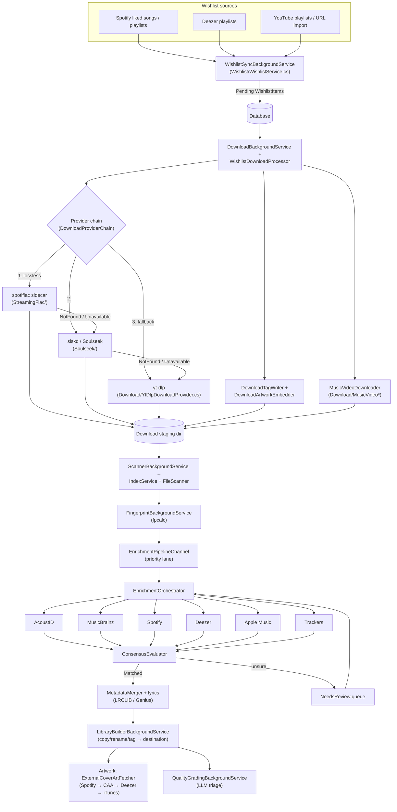

# External integrations & the metadata/matching/download pipeline

MusicHoarder's value comes from a chain of external services: it fingerprints audio
(AcoustID), matches it against music catalogs (Spotify, MusicBrainz, Deezer, Apple
Music/iTunes), fetches lyrics and artwork (LRCLIB, Genius, Cover Art Archive), and can
*acquire* missing music (slskd/Soulseek, a streaming-FLAC sidecar, yt-dlp/YouTube).
Everything lives under `MusicHoarder.Api/`, one folder per integration plus one folder per
pipeline stage, and every integration follows the same philosophy: **configured entirely
from environment variables, and inert when unconfigured** — the feature degrades
gracefully instead of failing.

This page covers *what talks to what, how credentials flow, and how the stages compose*.
For deployment variables and Docker setup, see [SELF_HOSTING.md](SELF_HOSTING.md); the
library build / dedup / review machinery is documented separately in this directory.

---

## The pipeline at a glance

Each stage is a .NET `BackgroundService` registered in
`MusicHoarder.Api/Composition/ServiceCollectionExtensions.cs` (scan → fingerprint →
enrich → build, plus the download/artwork/music-video/upgrade side services). Stages
communicate through the database (status columns on `SongMetadata` / `WishlistItem`
rows) and through channels (`EnrichmentPipelineChannel`, `MusicVideoChannel`,
`QualityUpgradeChannel`, `NavidromeLikeSyncChannel`):

```
source library (read-only)         wishlist / URL import
        │                                  │
        ▼                                  ▼
  [Scanner] ── indexes files ──▶ [Download] ── writes into staging dir
        │   Scanner/IndexService.cs       │   Download/DownloadBackgroundService.cs
        ▼                                 └──────────▶ triggers a scan ──┐
  [Fingerprint] (fpcalc)                                         ◀──────┘
        │   Scanner/FingerprintBackgroundService.cs
        ▼
  [Enrich] (AcoustID → MusicBrainz → Spotify → Deezer → AppleMusic → trackers)
        │   Enrichment/EnrichmentBackgroundService.cs
        ▼
  [Library build] (copy/rename/tag into destination)
            Library/LibraryBuilderBackgroundService.cs
        │
        ▼
  side services: artwork, music videos, quality grading, quality upgrades,
                 album completion, Navidrome/Sync/playlist export
```

Key design points:

- **The source library is never modified.** All work lands in a writable *destination*
  library (`MusicEnricher:DestinationDirectory`); downloads land in a writable *staging
  dir* (`MusicEnricher:DownloadDirectory`) which the scanner also indexes.
- **A missing binary or credential disables a stage, not the app.** No `fpcalc` → files
  are indexed but never fingerprinted; no AcoustID key → tracks rely on name matching and
  mostly land in review; no slskd/sidecar → the download chain falls through to yt-dlp.
- **Every pipeline stage is trigger-first, then sweeps.** Manual triggers arrive via
  `Jobs/JobManager` channels; background sweeps (auto-scan, retry, upgrade, completion)
  run on timers from `Options/MusicEnricherOptions.cs`.

---

## External integrations

| Integration | Folder | Auth | Primary use | When unconfigured |
|---|---|---|---|---|
| AcoustID | `Enrichment/` (+`Scanner/FpcalcService.cs`) | API key | Identify tracks by fingerprint | Names-only matching; most tracks land in NeedsReview |
| MusicBrainz | `Enrichment/` | none (polite UA + rate limit) | Canonical metadata, tracklists | Name matching loses its canonical anchor |
| Spotify | `Spotify/` | App client id/secret + per-owner OAuth | Enrichment, wishlist sources, liked-song sync, covers | Catalog lookups return empty; OAuth/wishlist features off |
| Deezer | `Deezer/` | none | Enrichment, ISRC lookup, discover playlists, covers | Feature simply absent |
| Apple Music (iTunes) | `AppleMusic/` | none (throttled by IP) | Enrichment, covers, clean-edit reference previews | Feature absent |
| Genius | `Enrichment/GeniusLyricsService.cs` | none (public pages) | Lyrics fallback when LRCLIB has none | Lyrics fallback skipped |
| LRCLIB | `Enrichment/LrcLibService.cs` | none | Synced + plain lyrics | Lyrics stages report NotFetched |
| Cover Art Archive | `CoverArtArchive/` | none | Album covers by MBID | Chain falls to Spotify/Deezer/iTunes art |
| slskd (Soulseek) | `Soulseek/` | API key + shared dir | Downloads & quality upgrades | Provider reports "not found", chain falls through |
| spotiflac sidecar | `StreamingFlac/` | sidecar URL only | Lossless FLAC downloads & upgrades | Provider reports "not found", chain falls through |
| yt-dlp / YouTube | `Download/`, `Import/` | local binary (optional cookies) | Downloads, URL import, metadata probes | Downloads fail with a classified error |
| Navidrome | `Navidrome/` | username + password | Two-way like sync over Subsonic API | Background sync never runs; local likes still work |
| AI grading / transcription | `Quality/`, `Enrichment/LyricsTranscription*` | OpenAI-compatible API key | LLM quality triage, Whisper lyrics transcription, translation | Features off / hidden in the UI |

---

### AcoustID

**What for:** identifies a track from its Chromaprint fingerprint, giving a MusicBrainz
recording id that anchors everything else.

- `Scanner/FpcalcService.cs` shells out to the `fpcalc` binary (`MusicEnricher:FpcalcPath`)
  to fingerprint a file (and get its duration). Missing binary → fingerprinting reports a
  classified failure and the enrichment provider never runs for that track.
- `Enrichment/AcoustIdService.cs` calls `acoustid.org/v2/lookup` with the key from
  `MusicEnricher:AcoustIdApiKey`, rate-limited to `AcoustIdRequestsPerSecond`; a 429 raises
  `ProviderRateLimitedException` so the orchestrator can back the whole provider off.
- `Enrichment/Providers/AcoustIdEnrichmentProvider.cs` (priority 100 — runs first) turns the
  lookup into a candidate; `Enrichment/AcoustIdMatchValidator.cs` sanity-checks it against
  the file's own tags.

**Credentials:** `ACOUSTID_API_KEY` env var (Docker), or the `acoustid-api-key` AppHost
parameter (`MusicHoarder.AppHost/AppHost.cs`) in dev. Free key from acoustid.org.

**Degradation:** `AcoustIdService.LookupAsync` logs a warning and returns `null` when the
key is empty. Without AcoustID the enrichment falls back to name-based providers only;
per [SELF_HOSTING.md](SELF_HOSTING.md) most tracks then land in the review queue rather
than auto-matching — AcoustID is the one optional key the guide calls *strongly
recommended*.

### MusicBrainz

**What for:** canonical release/recording metadata, per-release tracklists, and the
descriptive fields (label, catalog number, release dates, sort names).

- `Enrichment/MusicBrainzWebService.cs` — the web-service client; identifies itself with
  `MusicEnricher:MusicBrainzUserAgent` and honors MusicBrainz's 1 req/s etiquette
  (`MusicBrainzRequestsPerSecond`).
- `Enrichment/Providers/MusicBrainzWebEnrichmentProvider.cs` (priority 200) is the
  enrichment provider; `Enrichment/AlbumTracklist/Providers/MusicBrainzAlbumTracklistProvider.cs`
  is one of the parallel `IAlbumTracklistProvider`s that
  `Enrichment/AlbumTracklist/CanonicalAlbumFetchService.cs` races to fetch a canonical
  album's tracklist.

**Credentials:** none. **Degradation:** `MusicEnricher:EnableMusicBrainzWebProvider`
off, or network failure, just removes those candidates from consensus.

### Spotify

The largest integration — it is both a *metadata catalog* (client-credentials, anonymous)
and an *owner-identity service* (OAuth, per-owner tokens).

- **Catalog side** (client credentials): `Spotify/SpotifyClientCredentialsClient.cs` owns
  the app token, rate limit and retries; `Spotify/SpotifyCatalogSearchService.cs` builds
  lookups and caches them (`SpotifyApiSearchCacheMinutes`); `Spotify/SpotifyCatalogJson.cs`
  maps JSON to `SpotifyCatalogTrack`. Consumers: the enrichment provider
  (`Enrichment/Providers/SpotifyApiEnrichmentProvider.cs`, priority 300), cover art
  (`Artwork/ExternalCoverArtFetcher.cs`), album tracklists, and the ISRC resolver
  (`Spotify/SpotifyIsrcResolver.cs`) used before downloads.
- **OAuth side** (per-owner): `Spotify/SpotifyOAuthService.cs` (authorize + token
  exchange, scopes `user-library-read`, `playlist-read-private`,
  `playlist-read-collaborative`), `Spotify/SpotifyTokenRefreshService.cs` (background
  refresh well inside a 5-minute expiry buffer),
  `Spotify/SpotifyTokenRefreshHealthCheck.cs`, and
  `Spotify/SpotifyOAuthStateProtector.cs` (HMAC-signed OAuth state that lets a single
  registered *relay* redirect URI bounce the browser back to whatever environment started
  the flow — see the long doc comment on `Options/SpotifyOptions.cs`).
- **Credentials resolution:** `Spotify/SpotifyAppCredentialsResolver.cs` prefers the
  owner's Settings-UI row (DB, `SpotifySettings`) over the configured
  `Spotify:ClientId`/`ClientSecret`; `Spotify/SpotifyAppCredentialsProvider.cs` is the
  injectable form for background services.
- **Sync consumers:** `Spotify/SpotifyLibraryMatchBackgroundService.cs` (liked songs ↔
  library match cache), `Wishlist/WishlistSyncBackgroundService.cs` (wishlist sources),
  `Spotify/PlaylistExportService.cs` + `PlaylistExportBackgroundService.cs` (export the
  library back out), `Spotify/SpotifyTrackLibraryMatcher.cs` and
  `Spotify/ExplicitVersionMatcher.cs` (match + edition logic shared with downloads).

**Credentials:** `SPOTIFY_CLIENT_ID` / `SPOTIFY_CLIENT_SECRET` env (or AppHost parameters
`spotify-client-*`), the redirect URI registered in the Spotify dashboard
(`<PUBLIC_BASE_URL>/api/spotify/callback`, or the relay), and `Spotify:OAuthStateSigningKey`
when the relay is used. Per-owner tokens live in the DB, protected by
`ISecretColumnProtector`.

**Degradation:** with no client id/secret the catalog search returns empty (so the Spotify
enrichment provider never matches and `StreamingFlac`'s edition resolution falls back to
the requested id), the OAuth endpoints throw a clear "must be configured" error, and
wishlist sources / liked-song sync never run.

### Deezer

Free, no-auth catalog access — deliberately shaped like the Spotify catalog service minus
the OAuth dance.

- `Deezer/DeezerCatalogService.cs` — transport: URLs, shared rate limiter, 429/quota
  retries, caching, playlist paging. ISRC lookup (`/track/isrc:`), search, album/artist
  lookups. `Deezer/DeezerCatalogJson.cs` maps the JSON; `Deezer/DeezerCatalogTrack.cs` is
  the record.
- Consumers: `Enrichment/Providers/DeezerEnrichmentProvider.cs` (priority 250), cover art,
  `Enrichment/AlbumTracklist/Providers/DeezerAlbumTracklistProvider.cs`, discover/editorial
  playlists as wishlist sources (`WishlistSourceType.DeezerPlaylist`), and the Deezer half
  of the clean-edit reference client (below).

**Credentials:** none. **Degradation:** network failure → `ProviderRateLimitedException`
or empty candidates; the integration has no credentials to be missing.

### Apple Music / iTunes

Free, no-auth `itunes.apple.com` search/lookup — but iTunes throttles aggressively *by IP*
(~20 req/min), so this integration's whole design is about pacing.

- `AppleMusic/AppleMusicCatalogService.cs` — search + lookup, in-memory cache,
  `AppleMusicApiSearchLimit` / `AppleMusicCountry` from options.
- `AppleMusic/ITunesThrottle.cs` — **one** static rate limiter + backoff window shared by
  *every* iTunes caller (enrichment catalog and the clean-edit reference client), because
  the throttle is per-IP, not per-feature.
- Consumers: `Enrichment/Providers/AppleMusicEnrichmentProvider.cs` (priority 350), cover
  art, `Enrichment/AlbumTracklist/Providers/AppleMusicAlbumTracklistProvider.cs`, the
  album index (`AppleMusic/AppleMusicAlbumIndex.cs`), and — importantly —
  `CleanEdits/EditionReferenceClient.cs`, which uses iTunes/Deezer 30-second previews of
  *both editions* of a song as reference audio for clean-edit detection.

**Credentials:** none. **Degradation:** a tripped throttle raises
`ProviderRateLimitedException`; the orchestrator records a `RateLimited` attempt with a
`RetryAfterUtc` and re-sweeps later.

### Genius (lyrics fallback)

- `Enrichment/GeniusLyricsService.cs` reads lyrics from Genius's **public pages** — the
  official API needs a token and never returns lyrics, so there is no credential at all.
- `Enrichment/GeniusLyricsParser.cs` extracts the text; `Enrichment/GeniusHitMatcher.cs`
  checks a hit really is this song; `Enrichment/GeniusRefusalGate.cs` trips a cooldown
  (1 h → 24 h) after repeated refusals instead of hammering.

**Degradation:** `MusicEnricher:EnableGeniusLyrics` off → the lyrics fallback is skipped;
LRCLIB remains the primary source either way.

### LRCLIB (lyrics)

- `Enrichment/LrcLibService.cs` — `/api/get` exact match, then `/api/search` fallback,
  across the stored credit and the primary artist. Returns synced + plain lyrics and the
  duration LRCLIB believes the track has (a cheap check that the LRC was timed against the
  same recording — see `Enrichment/LyricsTimingValidator.cs`).
- Downstream: `Enrichment/LrcBuilder.cs` builds normalized LRC; `Enrichment/LyricsResync.cs`
  and `Enrichment/LyricsTimingCheckService.cs` keep timings honest;
  `Enrichment/LyricsTranscriptionService.cs` (Whisper via an OpenAI-compatible endpoint)
  and `Enrichment/LlmLyricsAligner.cs` are the *optional* AI path when LRCLIB has nothing —
  the whole feature is hidden in the UI until `LYRICS_TRANSCRIPTION_API_KEY` is set.

### Cover Art Archive

- `CoverArtArchive/CoverArtArchiveClient.cs` — front covers by release / release-group
  MBID, `front-1200` preferred with a `front` fallback, 20 MB cap, no auth. 404 is the
  normal "no art registered" signal.
- It is the second link in `Artwork/ExternalCoverArtFetcher.cs`'s chain:
  **Spotify → Cover Art Archive → Deezer → iTunes**, each gated by its own
  `MusicEnricher:Enable*Covers` flag; `Artwork/ExternalCoverArtSweepBackgroundService.cs`
  periodically retries songs still without art. Not-found results are retried after
  `ExternalCoverArtNotFoundRetryDays` (default 7).

### Soulseek via slskd

MusicHoarder **never joins the Soulseek network**; it talks to a user-operated
[slskd](https://github.com/slskd/slskd) instance over its REST API.

- `Soulseek/SlskdClient.cs` (`ISlskdClient`) — search start/poll + transfer management,
  `X-API-Key` auth, searches rate-limited (`SlskdOptions.SearchesPerMinute`, default 10 —
  Soulseek etiquette; the doc comment warns that aggressive automated searching gets peers
  banned).
- `Soulseek/SlskdSearchQuery.cs`, `Soulseek/SlskdCandidateSelector.cs` (rank candidates by
  lossless preference, bitrate floor, duration tolerance), `Soulseek/SlskdFileFetcher.cs`
  (poll a search, fetch a file), `Soulseek/SlskdModels.cs`.
- `Soulseek/SlskdDownloadProvider.cs` implements **both** `IDownloadProvider` and
  `IUpgradeProvider`; for upgrades it keeps only candidates *strictly better* than the
  target's current quality. `Soulseek/UpgradeMergeService.cs` verifies a downloaded upgrade
  (quality + same-recording fingerprint) before swapping it in.
- Endpoints: `Endpoints/SoulseekEndpoints.cs` (`/api/soulseek/status`, upgrade CRUD,
  admin-only).

**Credentials:** `Slskd:BaseUrl`, `Slskd:ApiKey`, and `Slskd:DownloadsDirectory` — the
last is a *shared filesystem* contract: slskd's completed-downloads dir bind-mounted into
the API container, from which finished files are moved into the normal staging dir.
Env: `SLSKD_URL`, `SLSKD_API_KEY`, `SLSKD_DOWNLOADS_HOST_PATH`.

**Degradation:** `SlskdOptions.IsConfigured` requires all three; otherwise the provider
returns `DownloadResult.Missing` and the chain falls through. A transport failure returns
`Failed` (stops the chain) only for a *reachable-but-broken* slskd; an unreachable one is
`Unavailable` and is retried later.

### Streaming-FLAC sidecar (`spotiflac`)

Legally-grey, **off by default**, and deliberately kept at arm's length: MusicHoarder
knows only a two-endpoint HTTP contract (`/health`, `/acquire`).

- `StreamingFlac/StreamingFlacSidecarClient.cs` — the client; maps outcomes to
  `AcquireStatus` { Ok, NotFound, Error, Unavailable }.
- `Download/StreamingFlacDownloadProvider.cs` — `IDownloadProvider` + `IUpgradeProvider`
  named `spotiflac`; resolves the Spotify track URL (or ISRC), and with
  `StreamingFlac:PreferExplicit` first swaps a clean edit for its explicit edition via
  `Spotify/ExplicitVersionMatcher.cs` (needs Spotify app credentials). It never
  re-downloads something already lossless.
- The sidecar itself is `sidecars/spotiflac/` (a small FastAPI wrapper) — shipped in
  `docker-compose.yml` behind a Compose profile so enabling it is pure `.env`
  (`COMPOSE_PROFILES=spotiflac`, `SPOTIFLAC_SIDECAR_URL`). See
  [SELF_HOSTING.md](SELF_HOSTING.md) for the full caveats.

**Degradation:** `StreamingFlacOptions.IsConfigured` requires `SidecarUrl`; unconfigured
or no upstream source → falls through to slskd/yt-dlp; a downed sidecar is `Unavailable`
and retried next sweep.

### yt-dlp / YouTube

The always-available fallback download provider, plus the URL-import path.

- `Download/YtDlpDownloadProvider.cs` — shells out to the `yt-dlp` binary
  (`MusicEnricher:YtDlpPath`); prefers native Opus/WebM to avoid re-encoding (format chain
  in `YtDlpDownloadProvider.FormatChain`); deliberately does **not** embed yt-dlp's
  metadata (uploader channel / video title would poison matching) — the caller stamps the
  authoritative identity via `Download/DownloadTagWriter.cs`. Before downloading a search
  result it skips unrequested clean edits (`Metadata/CleanEditLabel.cs`).
- `Download/YtDlpProcess.cs`, `YtDlpErrors.cs` (classified failures),
  `YtDlpCookies.cs` (optional cookie file for age-gated content).
- `Import/YouTubeMetadataResolver.cs` (`yt-dlp --dump-single-json --skip-download`) probes
  a URL for the import preview; `Import/YouTubePlaylistReader.cs` reads playlists;
  `Import/ImportUrlParser.cs` parses pasted URLs.

**Credentials:** none — just the binary on PATH (optional cookies). **Degradation:** a
missing binary is reported specifically ("yt-dlp is not installed on the server") instead
of blaming the video.

### Navidrome

Two-way sync of song likes/favorites with a Navidrome server over its **Subsonic API**.

- `Navidrome/NavidromeSubsonicClient.cs` (`INavidromeClient`) — `ping`, `getStarred2`,
  `search3`, `star`/`unstar`; auth is the Subsonic token scheme (per-request salt +
  `md5(password + salt)`, never the clear password). All Subsonic failures arrive as HTTP
  200 with an error envelope, surfaced as `NavidromeApiException`.
- `Navidrome/NavidromeLikeMatcher.cs` matches a MusicHoarder song to a Navidrome track in
  three rungs — library-relative path, MusicBrainz recording id, fuzzy artist+title+duration.
- `Navidrome/NavidromeLikeSyncBackgroundService.cs` + `NavidromeLikeSyncChannel.cs` run the
  two-way reconcile sweep every `Navidrome:ReconcileIntervalSeconds`; a like enqueued
  locally propagates to Navidrome and vice-versa.

**Credentials:** `Navidrome:BaseUrl` / `Username` / `Password` (env `NAVIDROME_URL`,
`NAVIDROME_USERNAME`, `NAVIDROME_PASSWORD`). **Degradation:** `IsConfigured` requires all
three; otherwise the background service never runs and likes remain local-only.

### AI services (grading, transcription, translation)

Three optional OpenAI-compatible LLM touchpoints, each keyed independently:

- **Quality grading** — `Quality/QualityGradingService.cs` + `Quality/OpenAiCompatibleChatClient.cs`
  (`IChatCompletionClient`). Sends a structured dossier (`Quality/QualityDossierFactory.cs`,
  `Quality/SongGradingDossier.cs`) of a song's match evidence to an LLM and records a verdict
  (excellent / questionable / wrong) used by the workbench buckets (`Quality/QualityBucket.cs`).
  `Quality/Jev/*` is a second, shadow-sampled grader variant (`Options/JevGradingOptions.cs`).
  Default base URL is OpenRouter (`https://openrouter.ai/api/v1`); key `QUALITY_GRADING_API_KEY`.
- **Lyrics transcription** — `Enrichment/LyricsTranscriptionService.cs` (Whisper-style audio
  → synced LRC), gated by `LYRICS_TRANSCRIPTION_API_KEY`, rate-limited by
  `Enrichment/LyricsTranscriptionRateLimiter.cs` with a daily audio budget
  (`Enrichment/TranscriptionAudioBudget.cs`); optionally cleaned up by an LLM
  (`Enrichment/LlmLyricsAligner.cs`).
- **Lyrics translation** — `Enrichment/LyricsTranslationService.cs` (+`Options/LyricsTranslationOptions.cs`),
  sharing the grading credentials.

**Degradation:** each option class has an `Enabled` flag and validators
(`Options/OptionsValidators.cs`); with no key the background services idle and the
UI features are hidden.

---

## Matching machinery (`Matching/`)

The shared scoring brain used by every name-based provider:

- `Matching/CatalogCandidateScorer.cs` — one confidence scorer for Spotify/Deezer/Apple
  Music candidates: artist+title agreement → ISRC corroboration → duration sanity check →
  version-qualifier guard → album tie-breaker → track-number tie-breaker. Provider-specific
  tuning lives in a `ScoringTuning` record, so the algorithm can't drift between providers.
- `Matching/SourceIdentityScorer.cs` — encodes the "embedded tag vs path-guess" rule for
  which identity to trust when tags and filenames disagree.
- `Matching/FuzzyTextMatch.cs`, `TitleNormalizer.cs`, `ArtistNameMatch.cs`,
  `VersionQualifier.cs` ("Live"/"Remix"/"Acoustic" can't satisfy a studio request),
  `MetadataQualityHeuristics.cs` (is an existing tag value worth keeping?),
  `MatchWarnings.cs` (human-readable reasons surfaced in the review UI).

`Metadata/` holds the small normalizers used everywhere: `ArtistCreditNormalizer.cs`,
`MultiValue.cs` (`;`-joined multi-value fields), `ReleaseDateParser.cs`,
`CleanEditLabel.cs`.

---

## End-to-end flows

### 1. Library import & scanning (`Scanner/`, `Library/`)

1. `Scanner/ScannerBackgroundService.cs` picks up scan triggers (manual button, or
   `Scanner/AutoScanBackgroundService.cs` every `AutoScanIntervalMinutes`) and reconciles
   roots in order: the download staging dir first (crash-recovery for downloads), the
   Sync-receive dir, then the (possibly network-mounted, read-only) source library.
   `Pipeline/DirectoryAvailabilityMonitor.cs` gates everything on the source dir actually
   being reachable, so an offline NAS idles instead of failing every track.
2. `Scanner/IndexService.cs` walks a root; `Scanner/FileScanner.cs` reads tags (TagLib)
   and duration per file, creating/updating `SongMetadata` rows with a status of
   *NeedsFingerprint*. A file must be stable for `ScanSettleSeconds` so a scan landing
   mid-copy never indexes a half-written file.
3. `Scanner/FingerprintBackgroundService.cs` runs `fpcalc` over unfingerprinted rows
   (`FingerprintConcurrency` in parallel), then hands the results to duplicate detection
   (`Scanner/DuplicateDetectionService.cs`, union-find over fingerprint matches in
   `Scanner/SongIdUnionFind.cs`) and enqueues the songs for enrichment.
4. Enrichment and the library build then take over (below).

### 2. Enrichment & matching (`Enrichment/`)

All enrichment work funnels through **one** channel — `Enrichment/EnrichmentPipelineChannel.cs`
— with a **priority lane** for freshly-acquired tracks so a new download isn't stuck
behind a thousands-deep backfill sweep. `Enrichment/EnrichmentBackgroundService.cs` runs
`EnrichmentWorkerConcurrency` workers plus startup sweeps (retry stale statuses, re-enqueue
songs under an older `EnrichmentAlgorithm` version, backfill missing providers/lyrics).

Per song, `Enrichment/EnrichmentOrchestrator.cs` runs the enabled `IEnrichmentProvider`s
in priority order, recording every attempt as a `SongProviderAttempt` row:

| Priority | Provider | Folder |
|---|---|---|
| 100 | AcoustID (fingerprint) | `Enrichment/Providers/AcoustIdEnrichmentProvider.cs` |
| 200 | MusicBrainz web | `Enrichment/Providers/MusicBrainzWebEnrichmentProvider.cs` |
| 250 | Deezer | `Enrichment/Providers/DeezerEnrichmentProvider.cs` |
| 300 | Spotify API | `Enrichment/Providers/SpotifyApiEnrichmentProvider.cs` |
| 350 | Apple Music (iTunes) | `Enrichment/Providers/AppleMusicEnrichmentProvider.cs` |
| 400/410 | Community trackers (artist-allowlisted) | `Enrichment/Providers/TrackerEnrichmentProvider.cs`, `YeTrackerEnrichmentProvider.cs` |

Rate limits are per-provider (`ProviderRateLimitedException` → a `RateLimited` attempt
with `RetryAfterUtc`); a persistently-throttled provider is bounded by
`RateLimitedSinceUtc` so consensus doesn't wait forever.

Then `Enrichment/ConsensusEvaluator.cs` decides the song's fate **by agreement, not by
any single provider**:

- ≥2 independent providers on the same identity → **Matched**;
- one strong name-based match at tuned thresholds → **Matched**;
- a confident tracker match (unreleased material no catalog can corroborate) → **Matched**;
- AcoustID alone → only **NeedsReview** — a fingerprint is a candidate, never proof.

The winning candidate is applied by `Enrichment/MetadataMerger.cs`, which never degrades
curated metadata: empty/low-quality values are filled, differing *good* values are only
overwritten by a strong multi-provider consensus (per-field corroboration), and anything
else becomes a *proposed* change for review. `Enrichment/EnrichmentAlgorithm.cs` versions
the whole scoring algorithm so bumps automatically re-process the review/failed backlog.

On the same flip-to-Matched run the orchestrator fetches lyrics (LRCLIB → Genius) and the
artwork/album machinery (cover fetch, canonical album consolidation in
`Library/CanonicalAlbumConsolidator.cs`, `Enrichment/AlbumTracklist/`) fills in the rest.

**Clean edits** (`CleanEdits/`): a downloaded track that turns out to be the censored
edition is detected by comparing the file's audio against iTunes/Deezer 30-second previews
of both editions (`CleanEdits/EditionReferenceClient.cs` → `CleanEdits/CleanEditChecker.cs`
→ spectral analysis in `CleanEdits/Fft.cs` / `BandSpectrogram.cs`); the verdict and its
evidence are stored for review. Where Spotify carries the explicit edition,
`Download/StreamingFlacDownloadProvider.cs` avoids the problem entirely by requesting it.

### 3. Downloading (`Download/`, `Wishlist/`)

The wishlist is the acquisition queue. Sources are Spotify Liked Songs / playlists,
Deezer discover playlists, YouTube playlists and single-URL imports
(`Persistence/WishlistSource.cs`).

1. **Sync** — `Wishlist/WishlistService.cs` pages a source and appends new `Pending`
   `WishlistItem`s; `Wishlist/WishlistSyncBackgroundService.cs` runs a cheap
   near-real-time fast poll of Liked-Songs (`LikedSongsFastPollSeconds`) plus a full sweep
   of every source every `WishlistSyncIntervalMinutes`. With `AutoDownloadWishlist` on it
   kicks the downloader directly.
2. **Download** — `Download/DownloadBackgroundService.cs` (trigger-first, then sweep)
   delegates to `Download/WishlistDownloadProcessor.cs`: items already in the library
   (exact match in the Spotify match cache) are `SkippedOwned`; the rest go through the
   configured **provider chain** (`MusicEnricher:DownloadProviders`, default compose order
   `spotiflac` → `slskd` → `yt-dlp`, resolved by `Download/DownloadProviderChain.cs`).
   Chain semantics (`Download/IDownloadProvider.cs`):
   - *NotFound* → try the next provider; all saying so → terminal NotFound.
   - *Unavailable* (provider unreachable) → next provider, retried later, never tombstoned.
   - *Failed* (reachable but broken) → **stop the chain**, retry with backoff, so a flaky
     backend can't burn the fallback's quota.
3. **Post-processing** — the downloaded file is stamped with the *known* Spotify identity
   (`Download/DownloadTagWriter.cs` — never the source's own tags), cover art is embedded
   (`Download/DownloadArtworkEmbedder.cs`), a companion music video is fetched from the
   same source video (`Download/MusicVideo*`), and a scan of the staging dir ingests the
   file into the normal scan → fingerprint → enrich pipeline.
4. **Side sweeps** — `Download/AlbumCompletionBackgroundService.cs` (fill missing tracks
   of owned albums, `EnableAlbumCompletion`), `Download/QualityUpgradeBackgroundService.cs`
   + `QualityUpgradeService.cs` (replace lossy with strictly-better copies via
   `IUpgradeProvider`s, verified by `Soulseek/UpgradeMergeService.cs`), and
   `Download/StagedSourceReleaseBackgroundService.cs` (release downloaded source files
   back to the source library after a build, when configured).

#### Download / enrichment pipeline



### 4. Streaming & quality (`StreamingFlac/`, `Quality/`, `Playback/`)

- **Quality model** — `Audio/AudioQuality.cs` tiers files (lossless / lossy by codec and
  bitrate) and `Audio/ChromaprintComparer.cs` + `Audio/FingerprintSimilarityGate.cs` decide
  whether two files are the same recording — the gate the upgrade merge relies on.
- **Quality grading (AI triage)** — `Quality/QualityGradingBackgroundService.cs` grades
  songs after enrichment (`AutoGradeAfterEnrichment`), producing verdicts consumed by the
  workbench (`Endpoints/QualityEndpoints.cs`, `Endpoints/AlbumQualityEndpoints.cs`).
  `Quality/AlbumGradingService.cs` grades whole albums with a bigger dossier.
- **Quality upgrades** — see the download flow above; an upgrade is only attempted when an
  `IUpgradeProvider.CanUpgrade(floor)` says the provider can actually beat the current tier.
- **Playback** — served straight from the destination library: `Endpoints/SongsEndpoints.cs`
  exposes a range-enabled audio stream per song (preferring the tagged destination copy);
  `Playback/PlaybackCoordinator.cs` implements "Connect"-style sync — one session and at
  most one active device per account, device reachability by open SSE stream + heartbeat
  (`Playback/PlaybackSubscriber.cs`, `Playback/PlaybackRules.cs`), with the durable half in
  `Persistence.PlaybackSession` flushed by `Playback/PlaybackSessionFlushService.cs`.
  Note `StreamingFlac/` is *not* playback — it is the lossless **download** sidecar above.

---

## Credential configuration summary

Two config surfaces, one pattern (empty committed values, real values from env/secrets):

1. **Docker Compose** — variables in `.env` mapped onto `Section__Option` env vars in
   `docker-compose.yml` (e.g. `SLSKD_API_KEY` → `Slskd__ApiKey`).
2. **AppHost (dev)** — `MusicHoarder.AppHost/AppHost.cs` parameters
   (`dotnet user-secrets set "Parameters:acoustid-api-key" … --project MusicHoarder.AppHost`),
   injected into the API project's environment.

| Credential | Option path | Env var |
|---|---|---|
| AcoustID key | `MusicEnricher:AcoustIdApiKey` | `ACOUSTID_API_KEY` |
| Spotify app id/secret | `Spotify:ClientId` / `ClientSecret` | `SPOTIFY_CLIENT_ID` / `SPOTIFY_CLIENT_SECRET` |
| Spotify OAuth relay/state key | `Spotify:OAuthRelayUrl` / `OAuthStateSigningKey` | AppHost parameters |
| slskd | `Slskd:BaseUrl` / `ApiKey` / `DownloadsDirectory` | `SLSKD_URL` / `SLSKD_API_KEY` / `SLSKD_DOWNLOADS_HOST_PATH` |
| spotiflac sidecar | `StreamingFlac:SidecarUrl` | `SPOTIFLAC_SIDECAR_URL` (+ `COMPOSE_PROFILES=spotiflac`) |
| Navidrome | `Navidrome:BaseUrl` / `Username` / `Password` | `NAVIDROME_URL` / `NAVIDROME_USERNAME` / `NAVIDROME_PASSWORD` |
| AI grading | `QualityGrading:BaseUrl` / `ApiKey` | `QUALITY_GRADING_API_KEY` |
| Lyrics transcription | `LyricsTranscription:BaseUrl` / `ApiKey` | `LYRICS_TRANSCRIPTION_API_KEY` |

Everything else (MusicBrainz, Deezer, iTunes, LRCLIB, Genius, Cover Art Archive) needs no
credentials — only rate-limit etiquette, which is enforced in code
(`RateLimiting/ReconfigurableRateLimiter`, `AppleMusic/ITunesThrottle.cs`).
